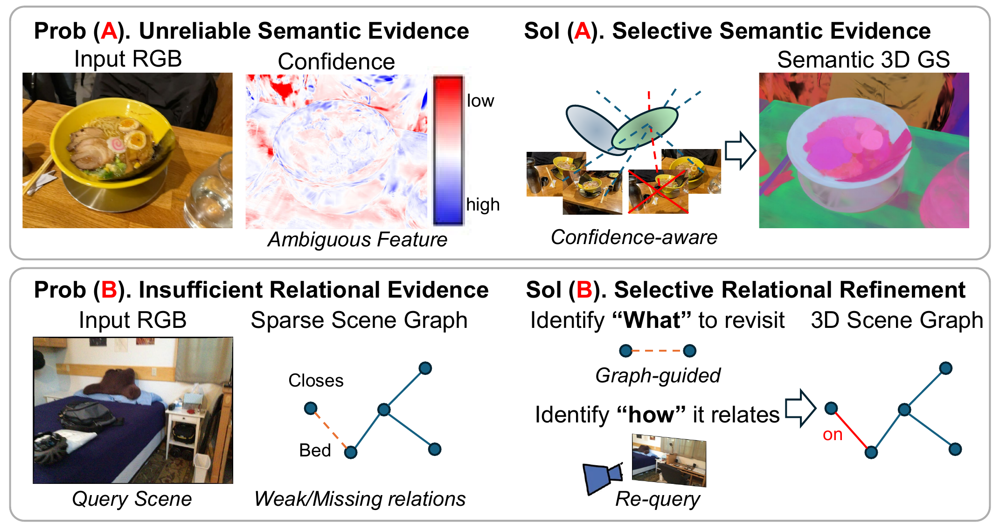

<div align="center">

# RelateGS: Reliable Semantic and Relational Evidence for 3D Scene Understanding with Gaussian Splatting

**WACV 2027**

Seongjun Choi · Sangyoun Lee<sup>†</sup>

Yonsei University · School of Electrical and Electronic Engineering

<sup>†</sup>Corresponding author

[](docs/index.html)
[](#)

</div>

<p align="center">
  
</p>

**TL;DR** RelateGS improves relation-aware 3D visual grounding by selectively refining the scene-side evidence of a language-aware Gaussian representation. It suppresses unreliable multi-view semantic observations and uses a persistent 3D object graph to identify and recover under-observed object relations from informative existing views.

## 📢 News

- **2026.10** RelateGS is accepted to **WACV 2027**! See you in Orlando.
- **Code release:** Implementation and model artifacts will be released progressively. Watch this repository for updates.

## 🗂️ Release Plan

- [ ] Inference code
- [ ] Pretrained checkpoints
- [ ] Training code
- [ ] Preprocessing data (relation annotation)

## 📖 Citation

```bibtex
@inproceedings{choi2027relategs,
  title     = {RelateGS: Reliable Semantic and Relational Evidence for 3D Scene Understanding with Gaussian Splatting},
  author    = {Choi, Seongjun and Lee, Sangyoun},
  booktitle = {Proceedings of the IEEE/CVF Winter Conference on Applications of Computer Vision},
  year      = {2027}
}
```
